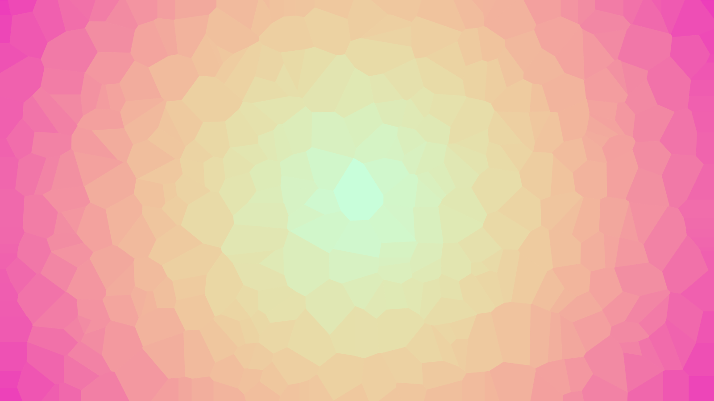

<p align="center">
  <a href="https://github.com/sponsors/niekes"></a>
</p>

<p align="center">
  <strong>A low poly art generator for the browser: any image or gradient, turned into triangles, cells or hexagons.</strong><br>
  Free and open source, kept alive by one maintainer and the people who sponsor the work.
</p>

<p align="center">
  <a href="https://github.com/Niekes/polify/actions/workflows/ci.yml"></a>
  <a href="https://github.com/Niekes/polify/actions/workflows/deploy.yml"></a>
  <a href="https://github.com/Niekes/polify/actions"></a>
  <a href="https://fallow.tools/docs/explanations/health/"></a>
  <a href="https://github.com/Niekes/polify/blob/main/LICENSE"></a>
  
  <a href="https://github.com/Niekes/polify"></a>
  <a href="https://github.com/sponsors/niekes"></a>
</p>

<p align="center">
  <a href="https://vuejs.org/"></a>
  <a href="https://vite.dev/"></a>
  <a href="https://vitest.dev/"></a>
  <a href="https://d3js.org/"></a>
  <a href="https://developer.mozilla.org/docs/Web/SVG"></a>
  <a href="https://daisyui.com/"></a>
  <a href="https://fallow.tools/"></a>
</p>

<p align="center">
  <a href="https://niekes.github.io/polify/">Live app</a> ·
  <a href="https://github.com/Niekes/polify/blob/main/CONTRIBUTING.md">Contributing</a> ·
  <a href="https://github.com/Niekes/polify/blob/main/AGENTS.md">Architecture &amp; quality gates</a>
</p>

---

<table>
    <tr style="background-color: #f6f8fa">
        <td><a target="_blank" href="https://niekes.github.io/polify/?c=N4Igzg9grgTgxgUxALlAawJYDsAmKQYC2AhgOZIA0IWxhSyBJ5AtAIwBMIVMEALsbwwQsKAAwBfKmAAWxAA70QvGBmJZSAG0oha0LLxQBmUaKoA3DACMYAoSOQAOU+AQI8yAOxViOAFZQwXjp9MBRQaSh6ZzABWFthFFYqDQxSaV4sBDBQ5CSQOGFlYkCxKgAzDA0NAHk5YjgMXgBPRKllCDQEWvrGltyqbDMEGANkMuINMAQqXmkYLOkIDXdxyemQUhsmsDgJ+lWp8XEgA"></a></td>
        <td><a target="_blank" href="https://niekes.github.io/polify/?c=N4Igzg9grgTgxgUxALlAawJYDsAmKQDmMAhjhglgC4gA0IJAtgA77aUIxMQA2x7AsggJ8YELLRCUAnkyTJ6pDMW4TiWAtzkAGOsTCy4lAEp8MEfAEYAbMgCcIAL50wAC2Kz8ibit0NoVFAAWLR0QADcMACMSSjNxO1CwBAQ8ZABmXRwAKygwSgYKSjAUUBcobWc+WFMxFAs6bgwCF0osBDBi5HqQODFKEjyUUIAzDG8AeSZiOAxpOud+iDQESenZqXmQbDCOamRh5SS6ShcYdpceVIPuI8ISKTA4ZTlrpIcHIA"></a></td>
        <td><a target="_blank" href="https://niekes.github.io/polify/?c=N4Igzg9grgTgxgUxALlAawJYDsAmKQDmMAhjhglgC4gA0IJAtgA77aUIxMQA2x7ACrzANitEJQCeTJMhDdsCYjDHEsBbjIDMABjrEw0uJQBKfDBHwBGAGzIAnCAC+dMAAti0-K4QAPYgQgsFQZoKhQAdm1dEAA3DAAjEkpzIORrACYXBAQ8ZEs9HAArKDBKBgpKMBRQVygZaLA+WDNAlHy5DAJXSiwEMCq8ujhAyhJSlG0AOkyQADMMbm4AeSZiOAxJNpdRiDQEFbWNiS2QbBiOamRZ4m4wBDpKVxg+1x5c69v7whIJMDgbmQfO6ORxAA"></a></td>
    </tr>
</table>

Every artwork is a link: open one above to change it in the [app](https://niekes.github.io/polify/).

## Sponsor Polify

**Polify** is free, and it always will be. There is no company behind it — just one maintainer working in spare time — so the cost of keeping it alive is paid for by the people who depend on it.

If Polify saves you time, [become a sponsor](https://github.com/sponsors/niekes).

| Tier        | What you get                                                                                |
| ----------- | ------------------------------------------------------------------------------------------- |
| **$5/mo**   | Your name in the [sponsors list](#sponsors) and my sincere thanks                           |
| **$25/mo**  | The above, plus your logo in this README and priority issue triage                          |
| **$100/mo** | The above, plus direct email access for feature requests and a mention in the release notes |

Where the money goes:

- **Issue triage and bug fixes.** Sponsorship buys a reply within a couple of days instead of whenever I get to it.
- **An engine that stays correct.** Keeping the triangulation, the color pipeline and the link format in shape as Vue and the browsers move on.
- **The gallery.** More images and gradients to start from.
- **Time for new work.** More shapes, better gradient controls, and whatever the community dreams up.

Prefer a one-off? The [sponsor page](https://github.com/sponsors/niekes) also takes one-time contributions.

**Need a company sponsorship or an invoice?** [Get in touch](mailto:s@niekes.com).

## Sponsors

Thank you to the people who make this possible. Sponsors at $25/mo and above get their logo in this README; everyone gets their name below.

<!-- New sponsors go below this line, one per line. -->

## Using Polify

No install — it runs in the browser at [niekes.github.io/polify](https://niekes.github.io/polify/). Uploaded images never leave your device.

To work on it locally:

```bash
pnpm install
pnpm dev
```

Everything about the codebase, the architecture zones and the quality gates lives in [AGENTS.md](AGENTS.md) and [CONTRIBUTING.md](CONTRIBUTING.md).

## Star History

[](https://www.star-history.com/#niekes/polify&type=date&legend=bottom-right)
